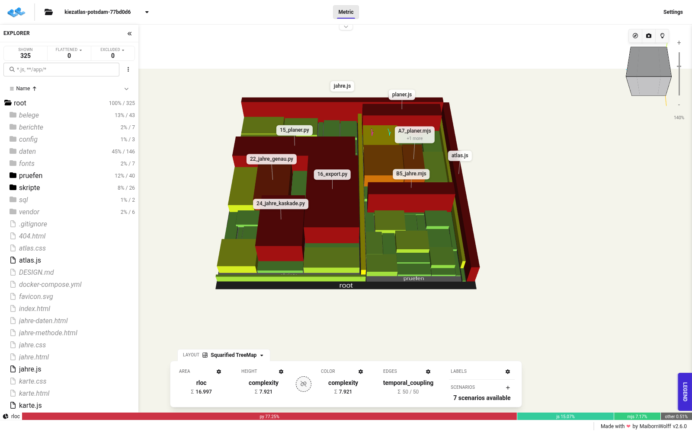

# Code-Karte

Der Code als Stadt: Jede Datei ist ein Gebäude. Die Grundfläche zeigt die Zahl der echten Codezeilen (`rloc`), Höhe und Farbe zeigen die Komplexität (grün einfach, gelb mittel, rot komplex). Ordner sind Stadtviertel.



Stand der Karte: Commit `77bd0d6` vom 06.11.2026 (Zweig `ausbau/3d-grundkarte`, 3D-Gebäude und Vektor-Grundkarte).

**Gezählt:** 65 Dateien mit eigenem Code, 16.997 echte Codezeilen, davon Python 77 % (`skripte/`, `pruefen/`), JavaScript 15 % (Seiten), Prüfskripte in JavaScript (`.mjs`) 7 %, Shell 0,5 %.

**Nicht gezählt** (Ausschluss beim Parsen, `meta.json`): `vendor/` (fremde Bibliotheken MapLibre GL JS und GSAP, minifiziert; sie würden die Karte mit über 15.000 Komplexitätspunkten überdecken), `daten/` (erzeugte Datendateien, kein handgeschriebener Code), `fonts/`. Diese Ordner erscheinen in der Karte nur über die Git-Historie, ohne Fläche.

So liest man das Bild: Die komplexesten Dateien sind die Seiten `jahre.js` (Bauzeiten) und `planer.js` (Planer) sowie die Auswertungsskripte `skripte/16_export.py` (GIS-Export), `skripte/15_planer.py` (Versorgung je Planungsraum), `skripte/24_jahre_kaskade.py` (Bauzeit-Schätzung) und `skripte/22_jahre_genau.py` (belegte Baujahre). Das Prüfviertel `pruefen/` ist fast so groß wie die Skripte: Jede Auswertung hat ihr eigenes Prüfskript, die Seiten werden im Browser ohne Netz geprüft (`B5_jahre.mjs`, `A7_planer.mjs`, `seiten.mjs`).

## Dateien

| Datei | Inhalt |
|---|---|
| `kiezatlas-potsdam-77bd0d6.cc.json.gz` | Karte im CodeCharta-Format (API 2.0) |
| `….sha256` | Prüfsumme der Karte |
| `meta.json` | Stand, Commit, Werkzeug mit Image-Digest, Ausschlüsse |
| `….png` | Vorschaubild |

## Erzeugung

Mit [CodeCharta](https://github.com/MaibornWolff/codecharta) (BSD-3-Clause), dasselbe Werkzeug und derselbe Image-Digest wie bei der Code-Karte der [Geodaten-Import-Pipeline](https://github.com/andremadstop/geodaten-import-pipeline/tree/main/docs/codekarte). Analyse im Container ohne Netz (`--network none`), aus einem frischen Klon des Commits. Autorennamen werden nicht erfasst; die Git-Auswertung enthält je Datei nur Zählungen (Commits, Zahl der Autoren, Kopplung).

```
codecharta/codecharta-analysis@sha256:ae97d9425ef81c00b52947a1d9d1c7cad1346204a3a288ef4fb90f07b7efd2b1
ccsh unifiedparser <repo> -e "/vendor/,/daten/,/fonts/" -o code.cc.json.gz
ccsh gitlogparser repo-scan --repo-path <repo> -o git.cc.json.gz
ccsh merge code.cc.json.gz git.cc.json.gz -o karte.cc.json.gz
```

## Ansehen

Der Viewer läuft lokal und schickt die Karte nirgendwohin (das Vorschaubild entstand so, mit gesperrten Fremdabrufen: 0):

```
docker run --rm -p 127.0.0.1:8598:80 -v "$PWD/docs/codekarte:/usr/share/nginx/html/daten:ro" \
  codecharta/codecharta-visualization@sha256:5e74d156dec7e07cf12c8475385c3c28374cc1dbb28153e5cfb0da3f7673d122
```

Dann im Browser öffnen:
http://127.0.0.1:8598/?file=/daten/kiezatlas-potsdam-77bd0d6.cc.json.gz&area=rloc&height=complexity&color=complexity
