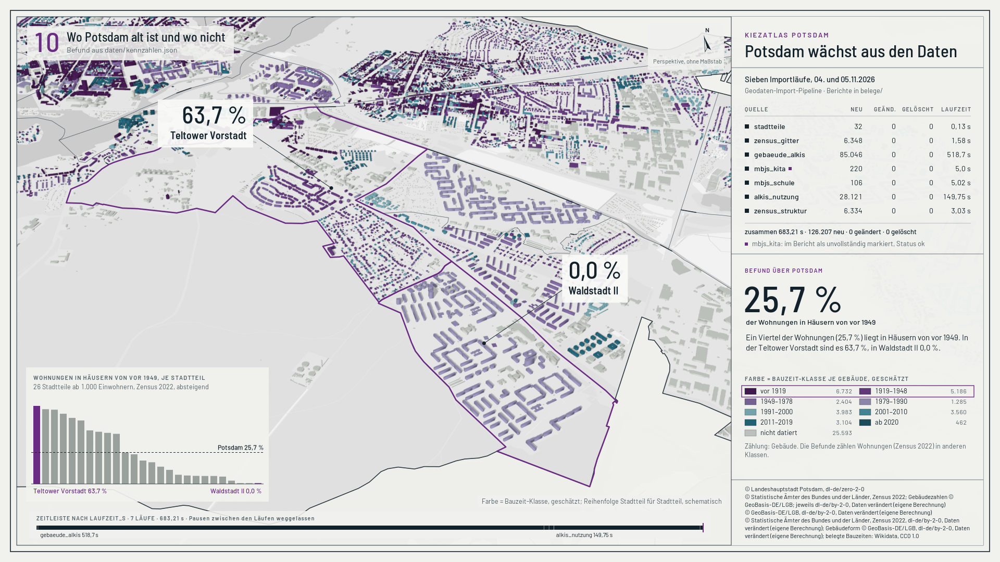
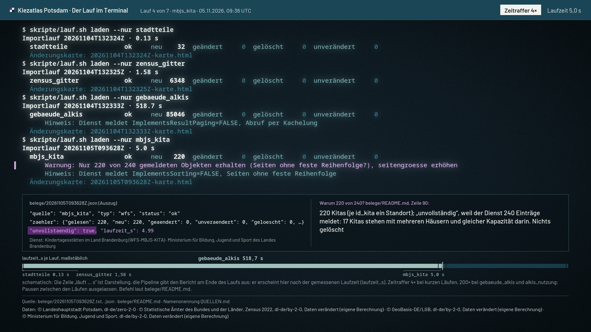
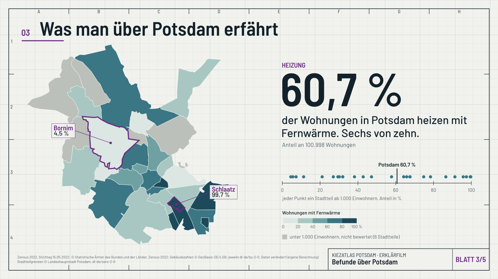

# Belegfilme

Drei kurze Filme ohne Ton zeigen, wie der Kiezatlas aus sieben Importläufen entsteht, wie er geprüft wird und was
man dabei über Potsdam erfährt. Jede Zahl im Bild liest das Skript beim Rendern aus einer Datei im Repository und
gleicht sie per `assert` ab; nichts ist abgetippt (Entscheidung A20 in [`../entscheidungen.md`](../entscheidungen.md),
Beleg [`../../belege/filme_20261108.md`](../../belege/filme_20261108.md)). Was schematisch ist, steht klein im Bild.
Alle drei: MP4, H.264, 1920 × 1080, 30 Bilder je Sekunde, yuv420p, `+faststart`.

| Film | Länge | Werkzeug | Was er zeigt |
|---|---|---|---|
| [**Potsdam wächst aus den Daten**](karte/README.md)  | 47,0 s, 13,7 MB | Blender 5.1 als Python-Modul `bpy`, pycairo, ffmpeg | Die sieben Läufe laufen über einer Karte von Potsdam ein, 85.046 Gebäude wachsen Kachel für Kachel. Danach die Zuordnung zu den 32 Stadtteilen, die geschätzte Bauzeit je Gebäude und der Befund: 63,7 % der Wohnungen in Häusern von vor 1949 in der Teltower Vorstadt, 0,0 % in Waldstadt II, Potsdam 25,7 %. |
| [**Der Lauf im Terminal**](terminal/README.md)  | 44,8 s, 8,1 MB | pycairo, NumPy, Pillow, ffmpeg (selbst gerendert, keine Bildschirmaufnahme) | Die echten Befehle und Berichtszeilen der sieben Läufe im Takt der gemessenen Laufzeit, der Kita-Lauf mit seiner Warnung „unvollständig“, `./pruefen.sh` mit 18 von 18 grün, zum Schluss Fernwärme gegen Altbau je Stadtteil (Rangkorrelation −0,66). |
| [**Was der Kiezatlas beantwortet**](erklaer/README.md)  | 74,2 s, 7,8 MB | Manim Community 0.22.1, ohne LaTeX | Fünf Zeichenblätter: warum es den Atlas gibt, wer welche Frage stellt, vier Befunde über Potsdam, was die Zahlen nicht sagen (Bauzeit-Schätzung, Rücktest, Grenzfall) und wie sich alles nachprüfen lässt. |

Je Ordner liegen `film.mp4`, `film.gif` (unter 6 MB, für die README), `standbild.png`, die Skripte und eine README
mit der Herkunft jeder Zahl, dem Schematischen, Datenschutz, Namensnennung und dem Weg zum Neubau. Arbeitsstände
gehören nach `berichte/` (von Git ausgeschlossen).

**Datenschutz:** kein Einzeljahr bei Gebäuden mit Wohnraum, keine Adressen, keine Gebäude- oder Zellkennungen; die
Bauzeit nur als Klasse und als Schätzung benannt (wie A3).

**Prüfung:** Die Skripte stehen nicht in `pruefen.sh`. Sie brauchen eigene Pakete (`bpy`, `manim`, `pycairo`), die
nicht in `requirements.txt` stehen, und prüfen ihre Zahlen selbst beim Rendern. Ändert sich ein Beleg, bricht der
Neubau ab.
