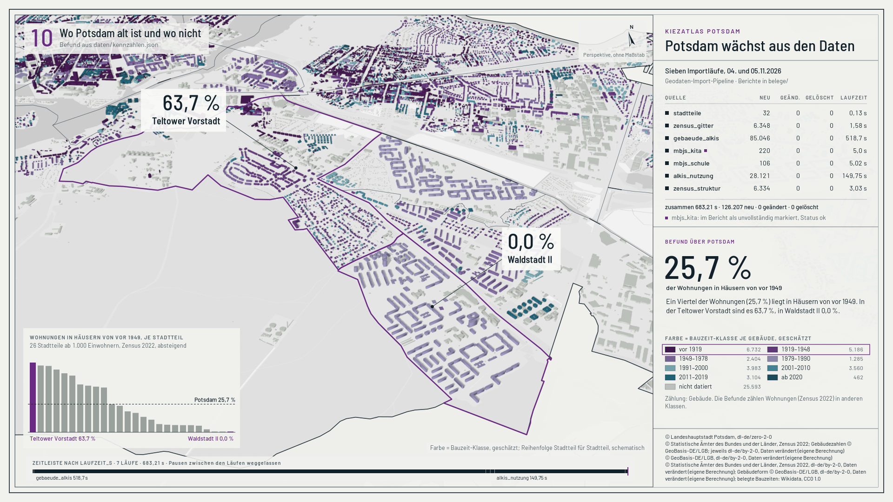

# Film: Potsdam wächst aus den Daten



`film.mp4` (47,0 s, 13,7 MB, 1920×1080, 30 fps, H.264, yuv420p) · `film.gif` (480 px breit, 4 fps, 5,65 MB, für die README)

## Was der Film zeigt

Die sieben Importläufe des Kiezatlas vom 04. und 05.11.2026 laufen in ihrer Reihenfolge (Startzeit im Bericht) über einer Karte von Potsdam ein, schräg von oben und mit ruhig fliegender Kamera. Danach zeigt der Film, was davon in Potsdam liegt, wie die Bauzeit je Gebäude geschätzt ist und was man daraus über die Stadt erfährt.

| Zeit | Abschnitt | Bild |
|---|---|---|
| 0 bis 2,4 s | 00 | leeres Papier, das Abrufrechteck aus `config/potsdam.yaml`; rechts vorab der Befund: 63,7 % gegen 0,0 % der Wohnungen in Häusern von vor 1949 (Teltower Vorstadt gegen Waldstadt II) |
| 2,4 bis 4,8 s | 01 `stadtteile` | die 32 Stadtteilgrenzen zeichnen sich (Lauf 0,13 s, im Film gedehnt) |
| 4,8 bis 8,0 s | 02 `zensus_gitter` | 6.348 Zellen füllen sich, Farbe nach Einwohnern je Zelle |
| 8,0 bis 19,0 s | 03 `gebaeude_alkis` | 85.046 Gebäude wachsen Kachel für Kachel aus dem Boden (380 Kacheln zu 1 km, zeilenweise ab Südwest wie die Pipeline). Die Kamera fliegt dabei tief über die Innenstadt |
| 19,0 bis 22,2 s | 04 `mbjs_kita` | 220 Kita-Standorte; die Warnung des Berichts steht wörtlich im Bild, darunter die Erklärung aus `belege/README.md` |
| 22,2 bis 24,2 s | 05 `mbjs_schule` | 106 Schulstandorte |
| 24,2 bis 28,0 s | 06 `alkis_nutzung` | 28.121 Nutzungsflächen in 100 Kacheln zu 2 km; Havel und Seen treten hervor |
| 28,0 bis 30,4 s | 07 `zensus_struktur` | 6.334 Strukturzeilen, die Zellen mit Strukturdaten leuchten auf |
| 30,4 bis 35,6 s | 08 Zuordnung | Erst wenn alle sieben Zeilen abgeschlossen sind (30,4 s), erscheinen die Summen. Danach tritt alles außerhalb der Stadt zurück: 85.046 → 52.309 Gebäude, 6.348 → 3.443 Zellen, die 91 bewohnten Zellen auf der Stadtgrenze sind markiert |
| 35,6 bis 38,8 s | 09 Auswertung | Die Gebäude färben sich Stadtteil für Stadtteil nach ihrer Bauzeit-Klasse (geschätzt). Die Zähler (geschätzt, belegt, nicht datiert, Anzahl je Klasse) zählen mit: Ein Stadtteil kommt hinzu, wenn er sich zu färben beginnt („Stadtteil 17 von 32“). Die Summen stehen erst, wenn der letzte Stadtteil begonnen hat (etwa 37,6 s) |
| 38,8 bis 44,0 s | 10 Befund | Die Kamera fliegt zu Teltower Vorstadt und Waldstadt II: 63,7 % gegen 0,0 % der Wohnungen in Häusern von vor 1949. Links unten wachsen Balken für alle 26 Stadtteile ab 1.000 Einwohnern, absteigend, mit der Linie für Potsdam (25,7 %); in der Legende sind die beiden Klassen vor 1949 umrandet |
| 44,0 bis 47,0 s | Abspann | zwei Befunde über Potsdam als Sätze in großer Schrift (auch am Handy lesbar), Hinweis auf die Lizenztexte, Namensnennung |

Rechts steht der Bericht als Tabelle: neu, geändert, gelöscht und Laufzeit je Lauf. Geändert, gelöscht und Laufzeit erscheinen erst, wenn eine Zeile abgeschlossen ist. Darunter läuft ein großer Zähler. Unten steht eine Zeitleiste, deren Abschnitte so lang sind wie `laufzeit_s` der sieben Läufe (683,21 s zusammen). Die Marke darauf zeigt den Stand im laufenden Lauf.

## Woher jede Zahl kommt

Kein Wert ist abgetippt. `prep.py` liest sie aus den Dateien unten, prüft Doppelquellen per `assert` und schreibt sie nach `meta.json`. `overlay.py` zeigt nur, was in `meta.json` steht.

| Im Bild | Datei, Feld | Gegenprobe in `prep.py` |
|---|---|---|
| Lauf-IDs, Datum, neu / geändert / gelöscht, Laufzeit je Lauf (0,13 / 1,58 / 518,7 / 5,0 / 5,02 / 149,75 / 3,03 s), Reihenfolge der Läufe | `belege/2026110*Z.json`: `lauf_id`, `start`, `laufzeit_s`, `quellen[0].zaehler` | Kopf- und Zählerzeile der gleichnamigen `.txt` |
| Summen 683,21 s, 126.207 neu, 0 geändert, 0 gelöscht | Summe über die sieben `.json` | gegen das Faktenblatt der Filmarbeit (optional `--fakten`) |
| Kita: „Nur 220 von 240 gemeldeten Objekten erhalten …“, Hinweis `ImplementsSorting=FALSE`, Marke „mbjs_kita: im Bericht als unvollständig markiert, Status ok“ | `belege/20261105T093628Z.json`: `quellen[0].warnungen`, `.hinweise`, `.unvollstaendig` (true), `.status` (ok) | Warnzeile gleich der `.txt`; 220 und 240 gleich der Erklärung |
| Erklärung „220 Kitas (je id_kita ein Standort); …17 Kitas stehen mit mehreren Häusern…“ | `belege/README.md`, Zeile mit der Lauf-ID (Zeilennummer wird im Bild genannt) | 220 = `neu` des Laufs |
| Abrufrechteck Gebäude und Nutzung 20 × 19 km (Kita und Schule fragen ein größeres Rechteck ab, es ist nicht gezeichnet), Kacheln 1.000 m (380) und 2.000 m (100) | `config/potsdam.yaml`, `gebaeude_alkis` und `alkis_nutzung`: `bbox`, `kachel_m` | letzte Kachel gleich `letzte_abfrage` im Bericht |
| Gebäude je Kachel (Zähler) | Datenbank, Tabelle `gebaeude` (über `holen.py`), linke untere Ecke des Umrisses | Summe = 85.046 = `neu` |
| 52.309 in Potsdam, 32.737 außerhalb | `daten/kennzahlen.json` `stadt.gebaeude.anzahl`, `kontrolle` | Anzahl in `daten/gebaeude/*.js` und `daten/jahre/*.js`, Datenbank (Punkt im Umriss wie `skripte/02_auswerten.py`); jedes Gebäude der Datenbank liegt in seinem Umriss aus `daten/` (größter Abstand 0,03 m) |
| Höhen: 50.356 Objekthöhe, 73 Geschosse × 3 m, 1.880 Ersatzwert 3 m | `daten/jahre_methode.js` `hoehe` | Zählung `hq` in `daten/gebaeude/*.js` = `daten/jahre/*.js` |
| 3.443 Zellen, 182.673 Einwohner | `daten/kennzahlen.json` `stadt.zellen`, Kachel `einwohner` | Anzahl und Einwohnerwerte von `daten/zellen.js` gleich den Datenbankzellen mit Mittelpunkt in Potsdam |
| Klassen „unter 9“ bis „90 und mehr“ Einwohner je Zelle und Anzahl je Klasse | Quintile über `ew` in `daten/zellen.js`, gerechnet wie `klassen()` in `themen.js` | – |
| 91 Grenzzellen, 1.605 Einwohner | `daten/kennzahlen.json` `grenzfall.stadt` | Zählung in der Datenbank (EPSG:3035, wie `02_auswerten.py`) |
| 6.334 Strukturzeilen | Lauf `20261105T101043Z` | Zeilen der Tabelle `zensus_struktur` = `neu` |
| Bauzeit: 26.610 geschätzt, 106 belegt, 25.593 nicht datiert, Anzahl je Klasse | `daten/jahre/*.js` (`k`, `g`), `daten/jahre_methode.js` `je_g` | Zählung = `je_g`; die Zählung je Stadtteil (`je_teil` in `meta.json`, für das Mitzählen) summiert sich zu denselben Werten, `overlay.py` prüft das beim Start noch einmal |
| Befund 25,7 %, Teltower Vorstadt 63,7 %, Waldstadt II 0,0 %; Fernwärme 60,7 %, Schlaatz 99,7 %, Bornim 4,5 %; Balken der 26 Stadtteile | `daten/kennzahlen.json`, Kacheln `altbau` und `fernwaerme` (Stadt und Stadtteile ab 1.000 Einwohnern) | Sätze gleich dem Faktenblatt (`--fakten`); „ein Viertel“ und „sechs von zehn“ per Bereichs-`assert` (24 bis 26 % bzw. 55 bis 65 %); erster und letzter Balken = Maximum und Minimum |
| Namensnennung (für jede Ebene, die gerade im Bild ist) | `daten/LIZENZ.md` (Spalte Namensnennung), `daten/einrichtungen.js` `quellen`, `daten/jahre/11.js` `quellen.zensus` | Wikidata CC0 im Eintrag zu `jahre_zellen.js` |
| Farben | `atlas.css` (`--k1` bis `--k5`), `jahre.js` (`PALETTE`, `GEB_ND`), `daten/grundkarte.js` (Grautöne) | – |

## Was schematisch ist

Im Bild steht unten rechts in jedem Abschnitt ein Hinweis.

- **Takt**: Jede Phase hat ihre eigene Filmdauer. Das Schriftfeld nennt Laufzeit, Filmdauer und Faktor, etwa „Zeitraffer 47ד oder bei den ersten Läufen „gedehnt“. Innerhalb einer Phase ist jede Kachel gleich lang. Linien, Zellen und Punkte erscheinen gleichmäßig verteilt. Die Pausen zwischen den Läufen (zwei Tage, verschiedene Uhrzeiten) fehlen.
- **Reihenfolge**: Gebäude und Nutzung kommen in der Kachelreihenfolge der Pipeline (`_kacheln`: zeilenweise ab Südwest). Ein Gebäude steht in der Kachel seiner linken unteren Ecke, dort hat es die Pipeline zuerst gesehen. Zellen erscheinen nach Gitterkennung, Stadtteile nach Nummer.
- **Höhe**: Der Gebäudelauf liefert nur Grundrisse. Die Höhe in Potsdam stammt aus dem ALKIS-NAS-Bestand der Auswertung (Objekthöhe, sonst Geschosse × 3 m, sonst 3 m). Außerhalb Potsdams gibt es keine Höhe, die Grundrisse liegen flach (1,2 m).
- **Farben**: „Dunkel“ heißt in diesem Lauf neu. Grau heißt Gebäude, noch ohne Bauzeit (die Farbe von „nicht datiert“ auf der Seite). Die Nutzung ist in fünf Gruppen mit den Grautönen der Grundkarte zusammengefasst, Siedlung und Verkehr haben denselben Ton.
- **Bauzeit**: Sie kommt aus keinem Lauf. Die Auswertung vom 06.11.2026 verteilt das Zensus-Baujahr je Zelle nach Gebäudeform auf die Häuser, 106 Bauzeiten sind belegt. Die Farbe ist die Klasse, nie ein Jahr. Gezählt sind Gebäude, die Befunde zählen Wohnungen (Zensus 2022, Mikrozensus-Klassen). Das sagt das Bild ebenfalls.
- **Zuordnung**: Außerhalb der Stadtgrenze legt sich Papier über die Karte. In Wirklichkeit ordnet `skripte/02_auswerten.py` mit PostGIS zu: Gebäude über einen Punkt im Umriss, Zellen über ihren Mittelpunkt.
- **Strukturlauf**: Das Aufleuchten steht für die zugeladenen Merkmale, Werte zeigt der Film nicht.
- **Befund-Fahnen**: Sie zeigen auf den Schwerpunkt der Gebäude des Stadtteils. Der Anteil gilt für den ganzen Stadtteil, auch für die unbebauten Teile innerhalb der Grenze.
- **Kamera**: Perspektive, deshalb ohne Maßstab. Der Nordpfeil ist aus der Kamera gerechnet. Die Nahgrenze der Kamera liegt bei 1.000 m (sie fliegt nie tiefer als rund 2,3 km), damit die flachen Ebenen (0 / 0,3 / 0,6 / 0,9 m) in der Tiefe sauber getrennt bleiben.

## Datenschutz

Der Film zeigt keine Adressen, keine Namen von Einrichtungen, keine Gebäude- oder Zellkennungen und kein Einzeljahr. `holen.py` exportiert keine Kennungen, `prep.py` liest das Feld `j` nicht. Die Bauzeit erscheint nur als Klasse und ist als Schätzung benannt.

## Neu bauen

Alle Befehle laufen aus der Repo-Wurzel. Zwischenstände liegen unter `berichte/filme-2026-11-08/karte/` und werden nicht versioniert. Gebraucht werden die laufende Kiezatlas-Datenbank, die nur gelesen wird, und kein Netz.

1. **Export aus der Datenbank** (schreibgeschützte Sitzung; Verbindung über `--psql` oder `KIEZ_PSQL`):

   ```sh
   python3 docs/filme/karte/holen.py --aus berichte/filme-2026-11-08/karte/daten
   ```

2. **Prüfen und vorbereiten** (Python 3.13 mit `numpy`, `shapely`, `mapbox_earcut`, `pyproj`; `--fakten` ist optional):

   ```sh
   python docs/filme/karte/prep.py --daten berichte/filme-2026-11-08/karte/daten --aus berichte/filme-2026-11-08/karte/prep
   ```

3. **Szene rendern** (Python-Modul `bpy` 5.1.2 im selben venv, EEVEE auf der GPU, 1.410 Bilder):

   ```sh
   python docs/filme/karte/szene.py --prep berichte/filme-2026-11-08/karte/prep --aus berichte/filme-2026-11-08/karte/frames
   ```

   `szene.py` überspringt Bilder, die es schon gibt; für einen Neubau den Ordner vorher leeren oder umbenennen. Am 08.11.2026 lief das auf einer GTX 1660 Ti in knapp 15 min (rund 0,6 s je Bild). Flatpak-Blender rendert auf diesem Rechner nur per Software (siehe Rezept), deshalb `bpy` per pip.

4. **Schrift und Beschriftung** (Barlow aus `fonts/`, pycairo):

   ```sh
   uv run --no-project --with fonttools --with brotli python docs/filme/karte/schriften.py --aus berichte/filme-2026-11-08/karte/fonts
   FONTCONFIG_FILE="$PWD/berichte/filme-2026-11-08/karte/fonts/fonts.conf" python docs/filme/karte/overlay.py \
     --prep berichte/filme-2026-11-08/karte/prep --ein berichte/filme-2026-11-08/karte/frames --aus berichte/filme-2026-11-08/karte/komp
   ```

   Fehlt die `fonts.conf`, nimmt cairo still eine Ersatzschrift. Mit `--jobs 6` dauert das knapp 1 min.

5. **Film, GIF, Standbild**:

   ```sh
   ffmpeg -framerate 30 -i berichte/filme-2026-11-08/karte/komp/o_%04d.png -c:v libx264 -preset slow -b:v 2350k -pass 1 \
     -tune animation -pix_fmt yuv420p -an -f null /dev/null
   ffmpeg -framerate 30 -i berichte/filme-2026-11-08/karte/komp/o_%04d.png -c:v libx264 -preset slow -b:v 2350k -maxrate 4000k \
     -bufsize 8000k -pass 2 -tune animation -pix_fmt yuv420p -r 30 -movflags +faststart docs/filme/karte/film.mp4
   ffmpeg -i docs/filme/karte/film.mp4 -vf "fps=4,scale=480:-1:flags=lanczos,split[a][b];[a]palettegen=max_colors=48:stats_mode=diff[p];[b][p]paletteuse=dither=none:diff_mode=rectangle" docs/filme/karte/film.gif
   cp berichte/filme-2026-11-08/karte/komp/o_1245.png docs/filme/karte/standbild.png
   ```

`zeitplan.py` hält Phasen, Kamera und Licht für Szene und Beschriftung gemeinsam. Beide rechnen dieselbe Lochkamera, deshalb sitzen Grenzen und Punkte Bild für Bild auf der Szene.

## Namensnennung

- Stadtteile: © Landeshauptstadt Potsdam, dl-de/zero-2-0
- Zensus, Kennzahlen: © Statistische Ämter des Bundes und der Länder, Zensus 2022; Gebäudezahlen © GeoBasis-DE/LGB; jeweils dl-de/by-2-0, Daten verändert (eigene Berechnung)
- Gebäude, Nutzung: © GeoBasis-DE/LGB, dl-de/by-2-0, Daten verändert (eigene Berechnung)
- Kitas, Schulen: © Ministerium für Bildung, Jugend und Sport, dl-de/by-2-0, Daten verändert (eigene Berechnung)
- Bauzeit: © Statistische Ämter des Bundes und der Länder, Zensus 2022, dl-de/by-2-0, Daten verändert (eigene Berechnung); Gebäudeform © GeoBasis-DE/LGB, dl-de/by-2-0, Daten verändert (eigene Berechnung); belegte Bauzeiten: Wikidata, CC0 1.0

Lizenztexte: dl-de/by-2-0 unter https://www.govdata.de/dl-de/by-2-0, im Bild aus Platzgründen ohne Adresse.

Skript und Film: André Stiebitz, Stiebitz Souverain Systems UG, mit KI-Unterstützung erstellt.
