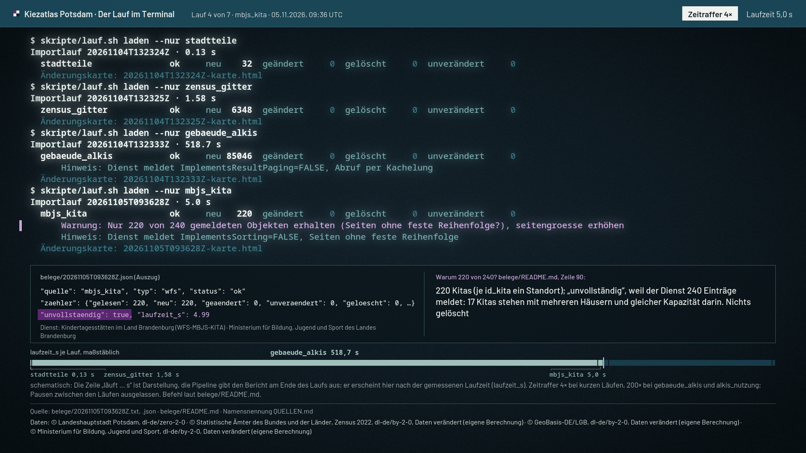

# Film: Der Lauf im Terminal



`film.mp4` (44,8 s, 1920×1080, 30 fps, H.264) · `film.gif` (960 px breit, 8 fps, für die README)

## Was der Film zeigt

0. **Titel** mit der Frage, auf die der Film hinausläuft: was die Läufe über Potsdam zeigen (Fernwärme und Altbau,
   Stadtteil für Stadtteil).
1. **Sieben Importläufe** des Kiezatlas, je Lauf eine Quelle (`skripte/lauf.sh laden --nur …`), in der Reihenfolge der
   Lauf-IDs vom 04.11.2026 (Stadtteile, Zensus-Gitter, ALKIS-Gebäude) und 05.11.2026 (Kitas, Schulen, ALKIS-Nutzung,
   Zensus-Struktur). Befehl und Berichtszeilen stehen so im Terminal, wie sie in den Laufberichten stehen. Unter dem
   Terminal erscheint nach jedem Lauf ein Auszug aus dem JSON-Bericht und der Satz aus `belege/README.md`, was der
   Lauf belegt.
2. **Der Kita-Lauf hält an.** Der Bericht meldet `ok`, aber auch die Warnung „Nur 220 von 240 gemeldeten Objekten
   erhalten“, und das JSON führt die Quelle unter `unvollstaendig`. Der Film zeigt die Warnzeile wörtlich, markiert
   `"unvollstaendig": true` und daneben die Erklärung aus `belege/README.md` (220 Kitas, je `id_kita` ein Standort;
   der Dienst meldet 240 Einträge, weil 17 Kitas mit mehreren Häusern darin stehen; nichts gelöscht).
3. **`./pruefen.sh`** am Stand `a057522` vom 08.11.2026: Kopf, die Abschnittszeilen aller 18 Prüfungen, drei Zeilen
   aus `pruefen/daten.py`, die die Zahlen des Schlussbilds prüfen, dann die Zählung
   „18 Prüfungen, 18 grün, 0 mit Befund, 0 übersprungen“ und die Rückgabe 0. Darunter füllt sich je Prüfung ein Feld;
   die gerade laufende Prüfung hat einen Petrol-Rahmen. Violett steht im ganzen Film nur für die Kita-Warnung.
4. **Was die Daten über Potsdam sagen** (erst nach der Zählung): 52.309 Gebäude in den 32 Stadtteilen (von 85.046
   geladenen), 182.673 Einwohner in 3.443 100-m-Zellen mit Mittelpunkt in Potsdam, 60,7 % der Wohnungen mit
   Fernwärme (Schlaatz 99,7 %, Bornim 4,5 %) und 25,7 % der Wohnungen in Gebäuden von vor 1949 (Teltower Vorstadt
   63,7 %, Waldstadt II 0,0 %), je mit einem Balken pro Stadtteil ab 1.000 Einwohnern. Dann sortieren sich die
   Altbau-Balken in die Reihenfolge der Fernwärme um, und drei Stadtteile sind in beiden Reihen hervorgehoben:
   Waldstadt II (99,4 % / 0,0 %), Historische Innenstadt (74,8 % / 42,6 %), Babelsberg Nord (7,3 % / 61,0 %).
   Merkzeile: „Tendenz: Je mehr Fernwärme, desto weniger Wohnungen von vor 1949.“ Darunter die Ausnahme mit viel von
   beidem (Historische Innenstadt) und die Rangkorrelation nach Spearman, −0,66 über die 26 Stadtteile.

## Woher jede Zahl kommt

Das Skript liest alle Texte und Zahlen beim Rendern aus den Dateien und prüft sie mit `assert`: Konsole gegen JSON
(Zähler, Laufzeit, Warnungen), Lauf gegen `kennzahlen.json` (85.046 = `kontrolle.gebaeude_im_rechteck`, 32
Stadtteile), `kennzahlen.json` gegen die Tabelle „Zur Prüfung“ im README und gegen die Zeilen von `pruefen/daten.py`
im Prüfprotokoll, Anteile gegen `zaehler / nenner`, die Zählung gegen die Abschnitte des Protokolls.
`python3 docs/filme/terminal/film.py --manifest` gibt jede verwendete Zahl als JSON aus.

Die Merkzeile ist gerechnet, nicht geschrieben: Das Skript bildet die Rangkorrelation nach Spearman (Bindungen
gemittelt) über die 26 Stadtteile ab 1.000 Einwohnern aus `daten/kennzahlen.json` und bricht ab, wenn sie über
−0,5 liegt. Die drei hervorgehobenen Stadtteile wählt es nach Regel: kein Altbau (kleinster Altbauanteil, zugleich
viel Fernwärme), viel Altbau ohne Fernwärme (größte Differenz Altbau minus Fernwärme), viel von beidem (größte
Summe). Die Merkzeile beschreibt eine Tendenz über Stadtteile, keine Ursache.

| Im Bild | Datei |
|---|---|
| Berichtszeilen der sieben Läufe | `belege/20261104T132324Z.txt` … `belege/20261105T101043Z.txt` |
| Laufzeit, Zeitleiste, JSON-Auszug, `unvollstaendig` | dieselben Läufe als `.json` (`laufzeit_s`, `quellen[0]`) |
| Befehl je Lauf | `belege/README.md`, Spalte „erzeugt von“ (dazu `skripte/lauf.sh`) |
| „Was der Lauf belegt“ | `belege/README.md`, Spalte „belegt“ |
| Erklärung 220 von 240 | `belege/README.md`, Tabelle „Ausbau“, Zeile zu `20261105T093628Z` |
| Dienstname beim WFS | `info.titel`, `info.kontakt.anbieter` im JSON (ohne E-Mail, ohne Abfrage-URL) |
| Prüflauf, Zählung, Dauer je Prüfung | `docs/filme/terminal/pruefen.log` (Prüfprotokoll von `./pruefen.sh`, siehe unten) |
| 52.309, 85.046, 182.673, 3.443, 60,7 %, 25,7 %, Werte je Stadtteil | `daten/kennzahlen.json` (`stadt`, `stadtteile`, `kontrolle`) |
| Merkzeile, −0,66, die drei hervorgehobenen Stadtteile | gerechnet aus `daten/kennzahlen.json` (Stadtteile ab 1.000 Einwohnern) |
| 6.348 geladene Zellen | `belege/20261104T132325Z.json` |
| Namensnennung je Szene | Importläufe: Spalte „Namensnennung“ in `QUELLEN.md` (Nr. 1, 2, 3, 5, 6, 7, 8) für die bis dahin gelaufenen Quellen; Prüflauf und Schlussbild: Zeile `kennzahlen.json` in `daten/LIZENZ.md` |

Im Bild fehlt bei den Vermerken nur die URL der Lizenz in Klammern, sonst stehen sie wörtlich wie in `QUELLEN.md`
bzw. `daten/LIZENZ.md`.

**Prüfprotokoll:** `pruefen.log` liegt neben dem Skript. Es entstand am 08.11.2026 um 07:28 CET mit einem Wrapper,
der jeder Zeile von `./pruefen.sh` (unverändert) die Ortszeit und die Sekunden seit Start voranstellt, im sauberen
Arbeitsstand `a057522`. Genau eine Zeile ist nachträglich geändert: In Zeile 441 steht statt des lokalen Pfads zur
GTFS-Datei `$KIEZ_DATEN/vbb_gtfs/2026-11-05/GTFS.zip`. SHA256 der Datei im Repo:
`5fb9ae7a5b46cf66fd0410ddaa7128c8682a8df988a75b142c9fbeb4a38f970e` (1.081 Zeilen); vor der Änderung
`157f1c9090fcf9f0d24116b6d8c55a41447e2a58a77498c49a8a1673189a3e83`. Das Skript nimmt diese Datei als Standard;
wer ein eigenes Protokoll hat, gibt es mit `--pruefen-log` an, Zahl der Prüfungen und Zeiten kommen dann aus diesem.

`belege/pruefstand-20261106-1cf8d56/pruefen.log` ist ein älterer Stand (Commit `1cf8d56`, 16 grün, 2 mit Befund,
siehe `belege/README.md`). Der Film zeigt den Stand `a057522`.

## Was schematisch ist

Im Film steht dazu jeweils eine Notiz.

- **Takt der Zeilen:** Die Zeile „läuft … s“ ist Darstellung. Der Bericht erscheint nach der gemessenen Laufzeit
  (`laufzeit_s`) im Zeitraffer: kurze Läufe 4×, `gebaeude_alkis` und `alkis_nutzung` 200×. Die Pausen zwischen den
  Läufen (bis zu einem Tag) sind ausgelassen. Die Zeitleiste ist maßstäblich nach `laufzeit_s`, also als Wiedergabe
  des Protokolls angelegt; Dauer und Name eines Segments erscheinen erst, wenn der Lauf fertig ist, die Summe erst
  nach dem letzten Lauf. Die Kopfzeile zählt während des Laufs nur hoch und nennt den Endwert erst danach.
- **Tippen:** Dass die Befehle getippt erscheinen, ist Darstellung. Die beiden ersten Läufe am 04.11. starteten
  0,4 s nacheinander, liefen also über ein Skript oder eine Befehlskette. Der Wortlaut der Befehle stammt aus der
  Spalte „erzeugt von“ in `belege/README.md`, nicht aus einem Konsolenmitschnitt.
- **JSON-Auszug:** Schlüssel in der Reihenfolge der Datei, `zaehler` nach fünf Einträgen mit `, …}` gekürzt
  (es fehlen `uebernommen` und `zurueckgehalten`, beide 0).
- **Zwei Laufzeiten:** Die Kopfzeile des Berichts nennt die Laufzeit des ganzen Laufs (`laufzeit_s`, z. B. 5.0 s beim
  Kita-Lauf), der JSON-Auszug darunter die der Quelle (`quellen[0].laufzeit_s`, 4.99). Beide stehen so in der Datei.
- **Prüflauf gekürzt:** gezeigt sind Kopf, die Zeilen `==` und `--` je Prüfung, drei Zeilen aus `pruefen/daten.py` und
  die Zählung; das Protokoll hat 1.081 Zeilen. Die Zeitstempel des Wrappers sind entfernt, die Rückgabe 0 steht im
  Feld unter dem Terminal. Zeitraffer 8× bis zum ersten Browser-Test, danach 120×. Die Felder je Prüfung sind
  Darstellung.
- **Schlussbild:** Die Balken wachsen ein und sortieren sich um, Endwerte wörtlich. Je Balken ein Stadtteil ab 1.000 Einwohnern (26 von
  32), weil kleine Gebiete durch die Geheimhaltung des Zensus (Cell-Key-Verfahren) unscharf sind. Anteile gegen alle
  Wohnungen des Gebiets wie auf der Seite.

## Daten und Datenschutz

Der Film zeigt nur Berichtszeilen und Kennzahlen, keine Karte, keine Adressen, keine Gebäude-IDs und keine
Einzeljahre. Er lädt nichts aus dem Netz. Namensnennungen: © Landeshauptstadt Potsdam, dl-de/zero-2-0 ·
© Statistische Ämter des Bundes und der Länder, Zensus 2022, dl-de/by-2-0, Daten verändert (eigene Berechnung) ·
© GeoBasis-DE/LGB, dl-de/by-2-0, Daten verändert (eigene Berechnung) · © Ministerium für Bildung, Jugend und Sport,
dl-de/by-2-0, Daten verändert (eigene Berechnung). Im GIF ist die Fußzeile klein; sie gilt auch dort.

## Gestaltung

Farben aus `atlas.css` und `DESIGN.md`: Grund `#13212a`, Phosphor in den Klassenstufen `#dce6e2 #a8c7c2 #6fa1a3
#3b7684`, Kopfleiste `#1c4a5b`, Warnung im hellen Grenzviolett `#c9a6d8`, Akzent `#6a2c82`. Violett heißt im Film
nur „Warnung“ (Kita-Lauf); laufende Prüfung, Zeitraffer-Wechsel und hervorgehobene Balken sind Petrol bzw. Papier
`#f1f2ee`. Kein Orange. Beschriftung
in Barlow aus `fonts/`. Das Terminal braucht eine Monospace-Schrift, die `fonts/` nicht hat; es nimmt Noto Sans Mono
(System, wie der Terminalfilm der Geodaten-Import-Pipeline). Dieselbe Schrift steht auch außerhalb des Terminals
für Wörtliches aus Dateien: JSON-Auszug, Etiketten der Zeitleiste (Quellnamen) und „Rückgabe pruefen.sh: 0“. Das
weicht bewusst von „keine Monospace-Etiketten“ in `DESIGN.md` ab: Monospace heißt im Film „steht so in einer Datei“.
**Offen, entscheidet André:** eine Monospace-Schrift in `fonts/` aufnehmen oder die Systemschrift freigeben.

## Neu bauen

Voraussetzungen: Python 3 mit `pycairo`, `numpy`, `Pillow`; `ffmpeg` mit libx264; `fc-match`; Noto Sans Mono im
System. Barlow kommt aus `fonts/*.woff2`: Das Skript nimmt die ttf-Fassung aus `--schriften <ordner>` (mit
`fonts.conf`) oder wandelt sie beim ersten Lauf nach `berichte/filme-schriften/` um (braucht `fontTools` und
`brotli`). Es bricht ab, wenn `fc-match` eine andere Schrift liefern würde.

```sh
# aus der Repo-Wurzel
python3 docs/filme/terminal/film.py --check       # Beschriftung: Rand, Überlappung
python3 docs/filme/terminal/film.py               # film.mp4 (H.264, yuv420p, +faststart)
python3 docs/filme/terminal/film.py --gif         # film.gif aus film.mp4
python3 docs/filme/terminal/film.py --standbild   # standbild.png (Kita-Warnung mit Erklärung)
python3 docs/filme/terminal/film.py --standbild befund   # Zahlenkarte mit Merkzeile, standbild-befund.png in --probe-dir
python3 docs/filme/terminal/film.py --still 16    # Probebild in --probe-dir (Standard berichte/filme-2026-11-08/terminal/)
python3 docs/filme/terminal/film.py --manifest    # jede Zahl mit Quelle
```

Weitere Optionen: `--pruefen-log <datei>` (Standard `pruefen.log` neben dem Skript), `--repo <wurzel>`,
`--jobs <n>` (Standard 6; geht Multiprocessing nicht, rechnet es seriell). Das GIF entsteht mit ffmpeg (8 fps,
960 px, entrauscht, Palette aus dem Film mit 80 Farben ohne Dithering). Die Palette allein würde das helle Violett der
Warnung zu Grau mitteln, deshalb setzt `render_gif()` Violett, zwei Abstufungen über dem Grund und den Akzent fest
in die Palette.

Skript und Film: André Stiebitz, Stiebitz Souverain Systems UG, mit KI-Unterstützung erstellt.
